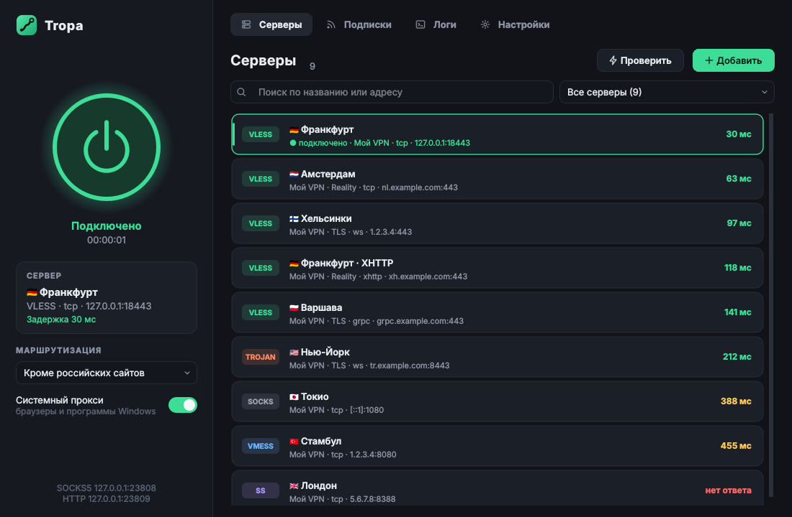

# Tropa — клиент для прокси-серверов на ядре Xray



Tropa — приложение для Windows, которое подключается к вашим прокси-серверам по ссылкам и подпискам
(то же, для чего используют Happ, v2rayN и похожие клиенты). Код, название, иконка и интерфейс написаны
с нуля. Сетевую часть выполняет открытое ядро [Xray-core](https://github.com/XTLS/Xray-core) (MPL-2.0),
которое приложение скачивает с официальной страницы релизов и проверяет по SHA-256.

## Что умеет

- **Протоколы:** VLESS (в том числе REALITY и Vision), VMess, Trojan, Shadowsocks (включая 2022-blake3),
  SOCKS5, Hysteria2 (с обфускацией salamander и сменой портов).
- **Транспорты:** TCP (RAW), WebSocket, gRPC, XHTTP, HTTPUpgrade, mKCP.
- **Импорт:** ссылки из буфера обмена (Ctrl+V), пачкой, в base64, а также подписки в формате
  ссылок или полного Xray JSON (с цепочками через `dialerProxy`, например фрагментацией).
- **Подписки:** название, трафик, срок действия и объявления из заголовков (`profile-title`,
  `subscription-userinfo`, `announce`), обновление при запуске, при обновлении сохраняется выбранный сервер.
- **Маршрутизация:** «Всё через прокси», «Кроме российских сайтов» (geosite/geoip RU напрямую),
  «Только мой список»; свои списки «всегда через прокси» и «всегда напрямую»; блокировка рекламы.
- **Проверка серверов:** реальная задержка через само ядро (все серверы параллельно) и быстрый TCP-пинг,
  сортировка по задержке. После подключения задержка проверяется автоматически.
- **Windows:** системный прокси (с восстановлением прежних настроек и после сбоя), трей,
  автозапуск, одна копия приложения, тёмный заголовок окна. Если Tropa закроется аварийно,
  ядро завершится вместе с ней и не займёт порты.
- Локальные порты: SOCKS5 `127.0.0.1:10808` и HTTP `127.0.0.1:10809` (меняются в настройках,
  можно открыть для локальной сети).

## Установка (обычный способ)

Нужна 64-битная Windows 10 или 11. Python не нужен.

1. Запустите **`Tropa-Setup-1.0.0.exe`**. Права администратора не нужны — программа ставится в
   `%LOCALAPPDATA%\Programs\Tropa` для текущего пользователя, ярлык появится в меню «Пуск»
   (и на рабочем столе, если оставить галочку).
2. Установщик не подписан цифровой подписью, поэтому Windows может показать окно «Система Windows
   защитила ваш компьютер». Нажмите **«Подробнее» → «Выполнить в любом случае»**.
3. Скопируйте ссылку на сервер или подписку и нажмите в Tropa **Ctrl+V** (или «Добавить → Из буфера обмена»).
4. Нажмите большую кнопку питания.

Ядро Xray уже входит в установщик. Обновить его можно в «Настройки → Ядро Xray».
Повторный запуск установщика обновляет программу: запущенная Tropa закроется сама, настройки и серверы
сохранятся. Удаление — через «Параметры → Приложения» или `Uninstall.exe`; там же можно выбрать,
удалять ли настройки и список серверов.

## Запуск из исходников

Дважды щёлкните **`run.bat`**. Если Python 3.10+ не найден, скрипт предложит поставить его автоматически
(через winget, без прав администратора) или подскажет, где скачать. При первом запуске создаётся окружение
с PySide6 (≈ 1–2 минуты), ядро Xray Tropa предложит скачать сама.

## Сборка

- **`build.bat`** — папка `dist\Tropa` с `Tropa.exe` (нужен Python).
- **`packaging\build_installer.bat`** — полный установщик `dist\Tropa-Setup-1.0.0.exe`: сборка Tropa.exe,
  скачивание ядра Xray с проверкой SHA-256 и упаковка в NSIS (нужны Python и
  [NSIS](https://nsis.sourceforge.io/Download)).
- **`packaging/build_on_linux.sh`** — то же на Linux через Wine; так собран выложенный установщик.

Сборка использует PySide6 6.9: версии 6.10+ на Windows требуют системную библиотеку ICU, которая есть
только начиная с Windows 10 1903.

## Где хранятся данные

`%LOCALAPPDATA%\Tropa`: `state.json` (серверы, подписки, настройки), папка `core` (ядро), `config.json`
(последний конфиг, переданный ядру — удобно для отладки). Пароли и ключи серверов лежат только там.

## Устройство проекта

```
main.py                  точка входа (в оконном режиме пишет ошибки в %LOCALAPPDATA%\Tropa\tropa.log)
tropa/links.py           разбор ссылок vless/vmess/trojan/ss/socks/hysteria2 и JSON-подписок
tropa/xray_config.py     сборка конфига Xray: исходящие, транспорты, TLS/REALITY, маршрутизация
tropa/subscriptions.py   загрузка подписок и разбор служебных заголовков
tropa/core.py            скачивание ядра с проверкой SHA-256, массовая проверка задержки
tropa/winutil.py         системный прокси, автозапуск, Job Object для дочерних процессов
tropa/storage.py         сохранение в JSON (атомарная запись)
tropa/ui/                интерфейс на PySide6 (Qt 6)
scripts/setup_env.cmd    поиск/установка Python и окружения для run.bat, build.bat, test.bat
packaging/               установщик: installer.nsi, version_info.txt, fetch_core.py, скрипты сборки
tests/                   тесты
```

## Тесты

`test.bat` (или `python -m unittest discover -s tests`). Если указать путь к ядру в переменной
`XRAY_BIN`, тесты дополнительно:

- проверяют каждый собранный конфиг настоящим ядром (`xray run -test`) во всех режимах маршрутизации;
- поднимают локальные серверы Xray (VLESS TCP/WS/gRPC/XHTTP/REALITY+Vision, VMess, Trojan,
  Shadowsocks, SOCKS, Hysteria2) и реально качают страницу через прокси, собранный из ссылки.

## Важно знать

- Ядро Xray больше не поддерживает отключение проверки сертификата (`allowInsecure`). Если в ссылке
  стоит `allowInsecure=1`, Tropa предупредит в логах; для серверов с самоподписанным сертификатом
  нужна ссылка с параметром `pcs` (отпечаток сертификата).
- Транспорты HTTP/2 и QUIC убраны из ядра — такие ссылки Tropa не добавит и объяснит почему.
- Ядро запрещает VLESS и Trojan без шифрования к публичным адресам — Tropa скажет об этом понятным текстом.
- Режим TUN (весь трафик системы, включая игры и программы без поддержки прокси) пока не реализован:
  работают программы, которые используют системный прокси или умеют SOCKS5/HTTP.

## Лицензия

Код Tropa распространяется по лицензии [MIT](LICENSE).

## Юридическое

Tropa не использует код, название, логотип или дизайн Happ: защищены именно они, а идея прокси-клиента
и поддержка открытых протоколов — нет. Используемые сторонние компоненты и их лицензии перечислены в
[THIRD_PARTY_NOTICES.md](THIRD_PARTY_NOTICES.md). Приложение не продаёт и не предоставляет серверы —
пользуйтесь своими и соблюдайте законы своей страны.
